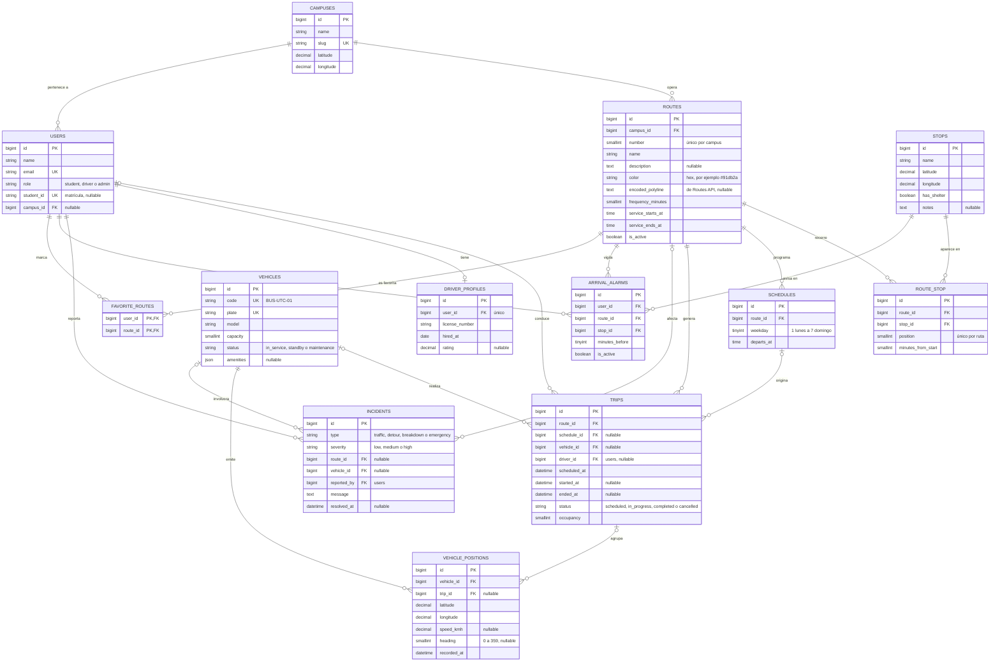

# Modelo de datos

Los tipos de TypeScript equivalentes están en `resources/js/types/transit.ts`;
si cambias una tabla, cambia también el tipo y su API Resource en el mismo PR.

## Estado de las tablas

| Tabla                                         | Modelo          | Migración creada en |
| --------------------------------------------- | --------------- | ------------------- |
| `campuses`                                    | `Campus`        | S1-01 (Jorge)       |
| `users` (+ `role`, `student_id`, `campus_id`) | `User`          | S1-02 (Jorge)       |
| `routes`                                      | `TransitRoute`  | S1-01 (Jorge)       |
| `stops`, `route_stop`                         | `Stop`          | S1-01 (Jorge)       |
| `vehicles`                                    | `Vehicle`       | S1-01 (Jorge)       |
| `driver_profiles`                             | `DriverProfile` | S1-01 (Jorge)       |
| `schedules`                                   | `Schedule`      | S1-01 (Jorge)       |
| `trips`                                       | `Trip`          | S1-01 (Jorge)       |
| `vehicle_positions`                           | pendiente       | S1-08 (Santana)     |
| `incidents`                                   | pendiente       | S4-04 (Enrique)     |
| `arrival_alarms`, `favorite_routes`           | pendiente       | S4-02 (Kiroz)       |
| `notifications`                               | estándar        | S4-01 (Santana)     |

- El modelo de la tabla `routes` se llama `TransitRoute` para no confundirlo con
  las rutas web; sus llaves foráneas son `route_id`.
- Los estados son enums de PHP en `app/Enums/` con su texto en español (`label()`).
- Para mandar datos a una página de Inertia se usan los API Resources de
  `app/Http/Resources/` (sin envoltura `data`); cada uno indica su tipo de
  TypeScript.
- Permisos: middleware `role:admin` (o `role:admin,driver`) para proteger rutas y
  policies en `app/Policies/` para cada modelo (`$user->can('update', $trip)`).

## Convenciones

- Tablas, columnas y valores de estado en inglés; textos de la interfaz en español.
- Todas las tablas llevan `created_at` y `updated_at`, salvo `vehicle_positions`
  (solo `recorded_at`) y `favorite_routes` (solo `created_at`). En el diagrama
  se omiten.
- Coordenadas en `decimal(10, 7)`. En los modelos se castean a `float` para que
  lleguen al frontend como número (el cast `decimal` las convierte en texto).
- Los estados se guardan como texto (`string`) y se validan con un enum de PHP.
- Horarios de salida (`departs_at`, `service_starts_at`) en hora local de
  Saltillo. Zona horaria propuesta: `America/Monterrey` (pendiente de confirmar).

## Diagrama entidad-relación

La tabla `notifications` es la estándar de Laravel
(`php artisan make:notifications-table`) y no aparece en el diagrama.

## Índices y restricciones

| Tabla               | Índice o restricción                        | Para qué                               |
| ------------------- | ------------------------------------------- | -------------------------------------- |
| `routes`            | único (`campus_id`, `number`)               | No repetir "Ruta 1" en el mismo campus |
| `route_stop`        | único (`route_id`, `position`)              | Orden de paradas sin huecos repetidos  |
| `schedules`         | único (`route_id`, `weekday`, `departs_at`) | Evitar salidas duplicadas              |
| `trips`             | índice (`route_id`, `scheduled_at`)         | Próximas salidas de una ruta           |
| `vehicle_positions` | índice (`vehicle_id`, `recorded_at`)        | Última posición de cada unidad         |
| `arrival_alarms`    | único (`user_id`, `route_id`, `stop_id`)    | Una alarma por parada y ruta           |
| `driver_profiles`   | único (`user_id`)                           | Un perfil por conductor                |

`vehicle_positions` crece rápido: una tarea programada borra los registros de
más de 7 días (S5-04).

## Valores de estado y su texto en pantalla

| Campo                | Valor              | Se muestra como |
| -------------------- | ------------------ | --------------- |
| `users.role`         | `student`          | Estudiante      |
|                      | `driver`           | Conductor       |
|                      | `admin`            | Administrador   |
| `vehicles.status`    | `in_service`       | En Ruta         |
|                      | `standby`          | En Espera       |
|                      | `maintenance`      | Mantenimiento   |
| `trips.status`       | `scheduled`        | Programado      |
|                      | `in_progress`      | En curso        |
|                      | `completed`        | Completado      |
|                      | `cancelled`        | Cancelado       |
| `incidents.type`     | `traffic`          | Tráfico         |
|                      | `detour`           | Desvío          |
|                      | `breakdown`        | Falla mecánica  |
|                      | `emergency`        | Emergencia      |
| `incidents.severity` | `low`              | Baja            |
|                      | `medium`           | Media           |
|                      | `high`             | Alta            |
| `vehicles.amenities` | `air_conditioning` | Climatizado     |
|                      | `wifi`             | WiFi Alumnos    |
|                      | `accessible_ramp`  | Rampa Accesible |

"Demorado" no es un estado guardado: se calcula para un viaje `in_progress` cuyo
retraso sobre su horario es de 5 minutos o más (umbral a confirmar en S2-07).

## Pendiente de confirmar en S0

- Zona horaria `America/Monterrey`.
- Umbral de "Demorado" (5 minutos).
- Días que se conservan en `vehicle_positions` (7).
- Datos de props por pantalla, con Kiroz y Sosa (S0-09).
